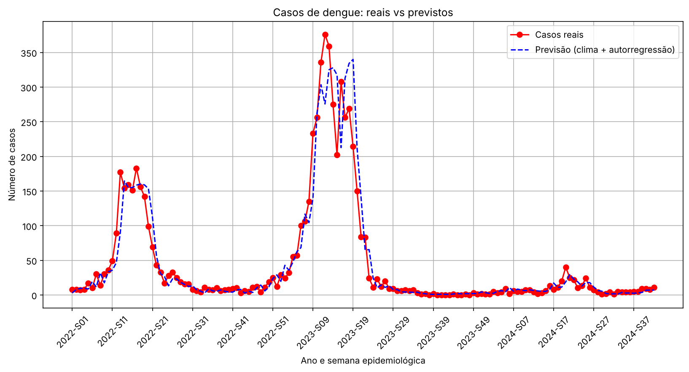
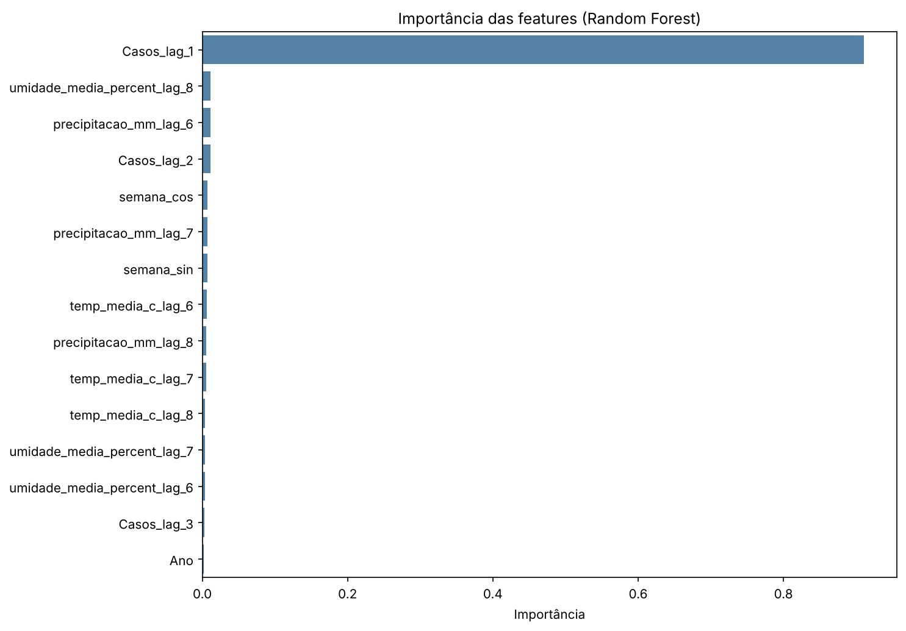

# Predição de Casos de Dengue com Dados Climáticos

Projeto de Iniciação Científica (UNILINS) que usa **Ciência de Dados e Machine Learning** para prever o número semanal de casos de dengue a partir de dados epidemiológicos do **DATASUS** e dados meteorológicos do **INMET**.

> **Município analisado:** [preencher] · **Período:** 2014 a 2024 · **Granularidade:** semana epidemiológica

## Objetivo

Construir um pipeline reprodutível que:

1. Integra séries de casos de dengue (DATASUS) e clima diário (INMET);
2. Investiga a relação entre chuva, temperatura, umidade e casos, considerando o atraso biológico entre clima e infecção;
3. Treina e avalia um modelo de regressão para prever os casos da semana seguinte.

## Metodologia

| Etapa | O que é feito |
| --- | --- |
| Limpeza (dengue) | Tabela do TabNet (semana × ano) convertida para formato longo; `-` vira 0 casos. |
| Limpeza (clima) | Conversão de tipos, corte no último dia com medição válida, precipitação ausente = 0, interpolação linear de temperatura e umidade. |
| Agregação | Dados diários agregados por semana ISO: chuva somada, temperatura e umidade em média. |
| Sazonalidade | Semana codificada com seno e cosseno, para o modelo entender que a semana 52 é vizinha da semana 1. |
| Lags climáticos | Chuva, temperatura média e umidade defasadas de 1 a 8 semanas (ciclo do mosquito + incubação). O modelo usa os lags de 6 a 8. |
| Autorregressão | Casos das 3 semanas anteriores. |
| Modelo | `RandomForestRegressor` (200 árvores). |
| Validação | Divisão temporal, sem embaralhar: treino de 2014 a 2021, teste de 2022 a 2024. |

## Resultados

Período de teste: 146 semanas (2022 a out/2024).

| Modelo | MAE (casos) | RMSE (casos) |
| --- | --- | --- |
| Random Forest (clima + autorregressão) | 12,56 | 26,24 |
| Baseline: repetir a semana anterior | 12,34 | 23,92 |



**Leitura dos resultados:** o modelo acompanha bem a forma das epidemias de 2022 e 2023, mas o desempenho ainda é equivalente ao baseline ingênuo. A importância das features mostra que o modelo depende quase só dos casos da semana anterior, e as variáveis climáticas ainda contribuem pouco. Isso orienta os próximos passos.



Outros gráficos em [`reports/figures/`](reports/figures/): casos por ano, mapa de correlação e correlação de cada variável com os casos.

## Estrutura do repositório

```
.
├── data/
│   ├── raw/                  # dados de entrada (DATASUS e INMET)
│   └── processed/            # gerado pelo pipeline (não versionado)
├── dengue_forecast/          # código-fonte
│   ├── config.py             # caminhos, colunas, features e hiperparâmetros
│   ├── data.py               # leitura, limpeza e unificação dos dados
│   ├── features.py           # sazonalidade e lags
│   ├── model.py              # divisão temporal, treino e métricas
│   ├── plots.py              # gráficos
│   └── train.py              # pipeline completo (ponto de entrada)
├── models/                   # modelo treinado (não versionado)
├── notebooks/
│   └── exploracao.ipynb      # notebook exploratório original (Google Colab)
├── reports/
│   ├── figures/              # gráficos gerados
│   └── metrics.json          # métricas da última execução
├── requirements.txt
└── README.md
```

## Como executar

Requer Python 3.10 ou superior.

```bash
git clone https://github.com/<seu-usuario>/<nome-do-repositorio>.git
cd <nome-do-repositorio>

python -m venv .venv
source .venv/bin/activate        # Windows: .venv\Scripts\activate
pip install -r requirements.txt

python -m dengue_forecast.train
```

Opções:

```bash
python -m dengue_forecast.train --test-start-year 2023   # muda o ano de corte treino/teste
python -m dengue_forecast.train --data-dir outra/pasta   # usa outra pasta de dados
python -m dengue_forecast.train --no-plots               # não gera os gráficos
```

Saídas geradas:

- `data/processed/historico_semanal.csv`: casos e clima por semana;
- `data/processed/dados_preparados.csv`: dataset final com features;
- `models/modelo_dengue_rf.joblib`: modelo treinado;
- `reports/metrics.json` e `reports/figures/*.png`: métricas e gráficos.

## Dados

| Arquivo | Fonte | Conteúdo |
| --- | --- | --- |
| `data/raw/dengue.csv` | [DATASUS / TabNet (SINAN)](https://datasus.saude.gov.br/informacoes-de-saude-tabnet/) | Casos prováveis por semana epidemiológica de início dos sintomas, 2014 a 2024 |
| `data/raw/clima_inmet.csv` | [INMET / BDMEP](https://bdmep.inmet.gov.br/) | Precipitação, temperatura máxima, média e mínima e umidade relativa diárias |

Os dois arquivos usam separador `;` e codificação `latin1`, no formato em que são exportados pelos portais.

## Limitações e próximos passos

- Superar o baseline ingênuo: testar previsão com horizonte maior (2 a 4 semanas à frente), onde o clima tende a pesar mais que o histórico recente.
- Comparar com outros modelos (Gradient Boosting, XGBoost, SARIMAX) usando validação cruzada temporal (`TimeSeriesSplit`).
- Alinhar semana ISO (clima) e semana epidemiológica (SINAN), que podem diferir em alguns anos.
- Prever a taxa de incidência (casos por 100 mil habitantes) para comparar municípios.

## Autora

**Patricia** · Engenharia de Software, UNILINS · [LinkedIn](#) · [GitHub](#)
